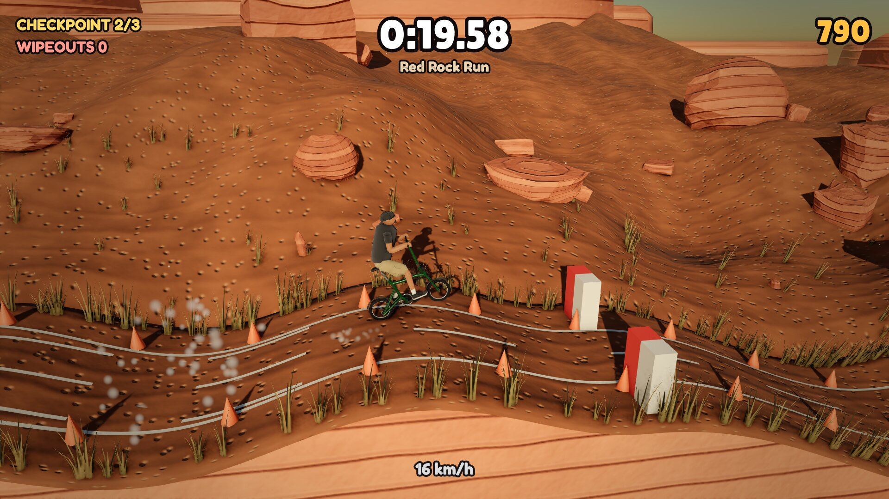
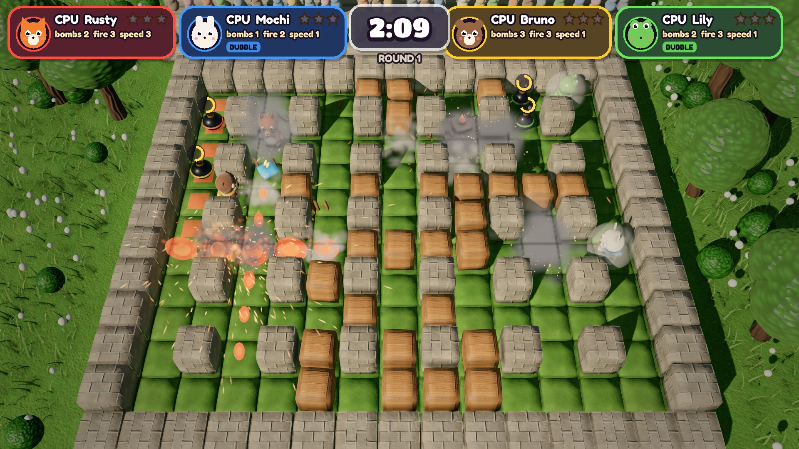
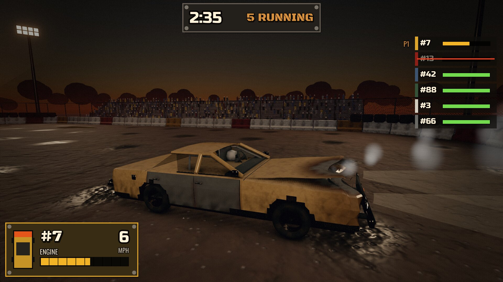
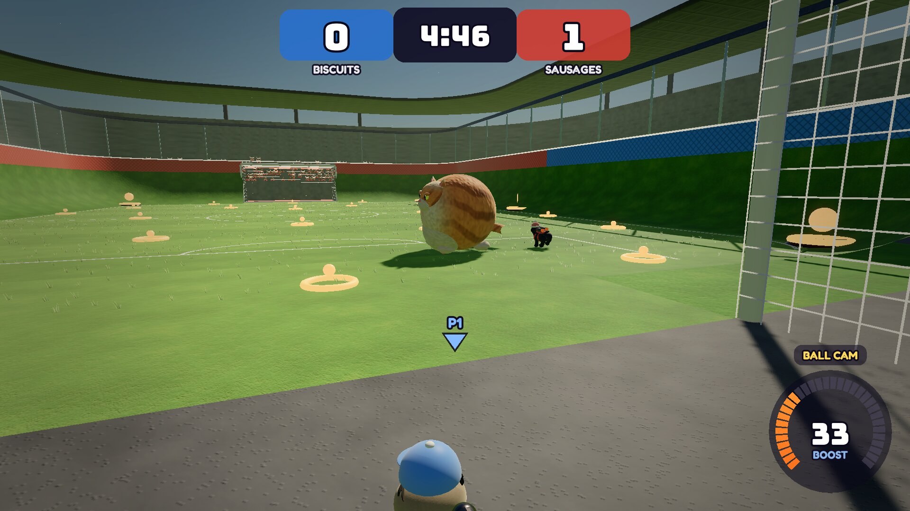
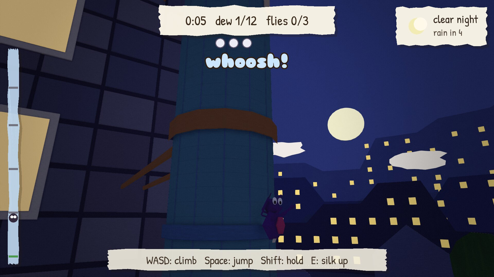

# cartwheel-examples

[](https://github.com/monteslu/cartwheel-examples/actions/workflows/ci.yml)

Five complete games built with
[cartwheel-engine](https://github.com/monteslu/cartwheel-engine), a 2D and 3D
game engine in C. Each game builds as a native executable and as a
[wasmcart](https://github.com/wasmcart/wasmcart) cart (`.wasc`) that runs in
a browser, in Node, in a native player and in RetroArch.

Everything in the games is made by code in this repository (models,
textures, levels, sound and music) except the fonts, which are SIL Open Font
License fonts shipped with their licences. Each game's `CREDITS` file says
what is what.

## The games

### BikeMesa




A downhill bike game. A 2D Box2D bicycle and rider ride hand-shaped lines
through thirteen 3D worlds, from a red rock canyon and a snowy slope to a
neon rooftop run, a haunted town, the Moon and Mars.
Pedal, hop, lean into flips, hold poses in the air and land clean; get it
wrong and the rider tumbles through a full 3D crash. Up to four players race
split screen in four lanes, one pad each: two share the screen top and
bottom, three or four take its quarters (with three, the last quarter holds
the race clock, a mini map of the course and the standings). Each player
picks a rider and a bike before the run.
`games/bikemesa/`

### BomberDude




A 3D arena bomber for one to four players and CPU rivals. Four critters,
eight themed arenas with their own twists (conveyor belts, ice, teleporters),
Battle and Adventure modes. The rules are integer only, so every host plays
the same game. `games/bomberdude/` (its
[README](games/bomberdude/README.md) has the full controls).

### derby




A demolition derby. Six cars on Box3D wheels in a walled dirt bowl; hits
dent the bodywork, then come smoke and fire, and the last car running wins.
Up to four players split screen, one pad each: players 2-4 join on the
title with (A), and CPU cars fill the bout to six. Two players share the
screen top and bottom; three or four take its quarters (with three, the
last quarter holds the clock, the standings and a map of the arena with
every car on it). Each player has their own chase camera and HUD.
`games/derby/`

### pugball




Soccer with jet-pack pugs and a fat, cross cat for a ball. 1v1 to 3v3 with
players and CPUs, five stadiums and the Pug Cup to unlock them. Up to four
players share the screen, one pad each: pads 2-4 join on the team sheet and
pick their side, and CPUs fill the other slots. Two players split the screen
top and bottom, three or four take its quarters (with three, the last
quarter holds the score, the clock and a mini map of the pitch). Each player
has a chase camera with its own ball cam and boost gauge. The match runs on
Box3D. `games/pugball/`

### spout




A paper spider climbs a rain spout. The weather turns from sun to rain;
rain makes the paper wraps slick and sends water down the spout, so brace
or be washed back to the last bracket. Five spouts, each opening the next.
`games/spout/`

## Play the carts

Tagged versions are on the
[Releases](https://github.com/monteslu/cartwheel-examples/releases) page, with
all five carts attached. Every push also builds them: the repository's
[Actions](https://github.com/monteslu/cartwheel-examples/actions) tab, the
latest green run on `main`, then **Artifacts** at the bottom of the run
page: `carts-<commit>` is a zip of all five. Each `<game>.wasc` carries GL
and WebGPU in one cart: it uses WebGPU where the host has it and GL
otherwise.

Hosts that run them:

- [wasmcart](https://github.com/wasmcart/wasmcart), the web and Node player:
  `npx wasmcart bikemesa.wasc`
- [wasmcart-native](https://github.com/wasmcart/wasmcart-native), a native
  player
- [wasmcart-libretro](https://github.com/wasmcart/wasmcart-libretro), a
  libretro core for RetroArch (it runs a cart's GL path)

## Build

You need Linux with cmake, ninja, a C17 compiler, SDL2, EGL and GLESv2
development packages, Node.js, git, curl and unzip. On Ubuntu:

```sh
sudo apt-get install cmake ninja-build libsdl2-dev libegl-dev libgles-dev nodejs npm curl unzip
```

Then:

```sh
scripts/fetch-deps.sh   # cartwheel-engine at the commit in scripts/deps.lock, and the engine's own dependencies
scripts/build.sh        # build/native, build/cart and build/cart-wgpu
```

`scripts/fetch-deps.sh` checks out cartwheel-engine into
`deps/cartwheel-engine` and runs its `scripts/fetch-deps.sh`, which fetches
three.c, Box2D, Box3D, wasi-sdk, wasmcart and the rest into
`deps/cartwheel-engine/deps/`. Everything it fetches is pinned.

`scripts/build.sh` builds three trees:

| Tree | What | Where |
|---|---|---|
| `build/native` | native executables | `build/native/project/games/<game>/<app>` |
| `build/cart` | GL carts | `build/cart/carts/<app>.wasc` |
| `build/cart-wgpu` | dual GL + WebGPU carts | `build/cart-wgpu/carts/<app>.wasc` |

`TARGETS="native"` (or `cart`, `cart-wgpu`) builds one tree,
`BUILD_TYPE=Debug` makes a debug build, and any arguments are ninja targets:
`scripts/build.sh pugball` builds only pugball in each tree. The cart trees
pack assets with the native tree's `cwpack`, so build native first.

## Run

Natively:

```sh
build/native/project/games/pugball/pugball
```

The carts with any wasmcart host:

```sh
npx wasmcart build/cart-wgpu/carts/pugball.wasc
```

Or through the engine's runner, which drives every host the same way (frame
count, input script, screenshot, debug state):

```sh
CW_PROJECT_ROOT=$PWD node deps/cartwheel-engine/tools/run-cart.mjs --host native --app pugball --frames 300 --shot out/pugball.png
```

## Tests

Each game has gates in `tests/gates.json`. A gate runs an app on every host
it names with the same frame count and input script, and compares each run
with the native one: the frames within a pixel bound, and the game's named
debug state (scores, positions, hashes of the simulation) exactly. Each gate
also runs a control (one frame short, or a different input) that must fail,
so a gate that cannot tell runs apart fails too. Gates with a `webgpu`
entry run again on WebGPU and are compared with the GL run.

```sh
node tests/gate.mjs --hosts native                    # every gate, native, GL
node tests/gate.mjs --hosts native --gpu webgpu       # the same on WebGPU
node tests/gate.mjs bikemesa-ride derby-auto          # some gates, every host they name
```

`tests/gate.mjs` runs cartwheel-engine's gate runner with
`CW_PROJECT_ROOT` set to this repository. The engine's
[testing guide](https://github.com/monteslu/cartwheel-engine/blob/main/docs/guides/testing.md)
covers the hosts (native, Chromium, wasmcart-native, romdev), the test GPU
settings it expects in `~/.config/cartwheel/`, and the gate format.

Without GPU hardware, `CW_TEST_GPU=software` runs on Mesa's software
renderers (llvmpipe for GL, lavapipe for WebGPU), as CI does:

```sh
CW_TEST_GPU=software node tests/gate.mjs bikemesa-auto --hosts native
CW_TEST_GPU=software node tests/gate.mjs bikemesa-auto --hosts native --gpu webgpu
```

### Split-screen cost

`tests/bikemesa-split-bench.mjs` measures what each extra player costs:
the self-playing BikeMesa on the same ride with one to four riders, native,
GL and WebGPU, on the test GPU. Per player count it prints the CPU per frame
on the main thread's clock (simulation and render submission), the GPU time
per frame by pass, the draw calls, and each against one player in percent.

```sh
node tests/bikemesa-split-bench.mjs                         # GL and WebGPU, 1-4 players, 3 runs each
node tests/bikemesa-split-bench.mjs --gpus webgpu --runs 5
```

`tests/pugball-split-bench.mjs` does the same for Pugball: one 2v2 in the
first stadium with one to four players (CPUs fill the other pugs), every pad
driving at the cat from the kickoff (`tests/pugball-split1.json` to
`pugball-split4.json`). The CPU numbers come from runs without GPU timers,
the GPU numbers from runs with them.

```sh
node tests/pugball-split-bench.mjs                          # GL and WebGPU, 1-4 players, 5 rounds
node tests/pugball-split-bench.mjs --gpus gl --players 1,4 --runs 3
```

`tests/derby-split-bench.mjs` plays one Derby bout at 1920x1080 with one to
four players, every pad joining on the title and then driving its own line
into the same pile-up. `--pairs N` also runs one player and n players side
by side N times: both see the same load on a busy machine, so their ratio
holds still where runs one after the other drift. Run it through the
engine's GPU suite wrapper:

```sh
node deps/cartwheel-engine/tools/with-gpu-suite.mjs derby-split-bench node tests/derby-split-bench.mjs
node deps/cartwheel-engine/tools/with-gpu-suite.mjs derby-split-bench node tests/derby-split-bench.mjs --pairs 7 --gpus webgpu --players 1,4
```

## CI

[`.github/workflows/ci.yml`](.github/workflows/ci.yml) runs on every push to
`main`, on pull requests and by hand (workflow_dispatch), in two jobs. The
first builds the five carts and uploads them as the `carts-<commit>` artifact,
kept for 30 days. The second runs each game's `_auto` gate natively on GL
and then on WebGPU, with Mesa's software renderers at the games' own 960x540
(`CW_RENDER_SCALE=1`). Both cache `deps/`. The full gate set runs locally
with `tests/gate.mjs`.

Pushing a `v*` tag runs the same jobs and publishes the five carts as a GitHub
release: `git tag v0.2.0 && git push origin v0.2.0`.

## Layout

| Path | Contents |
|---|---|
| `games/<game>/` | one game: its C sources, `CMakeLists.txt`, `CREDITS`, `assets/` and `tools/` |
| `games/<game>/assets/` | what the game packs: scenes, colour grades, audio, fonts, `roots.txt` (the pack manifest), `input.cfg`, `project.cwproj` |
| `games/<game>/tools/` | the scripts that generate the game's assets and gate inputs, committed next to their output |
| `games/<game>/programs/` | the game's three.c program table: `<game>.txt` and the C generated from it |
| `tests/gates.json` | every gate |
| `tests/<game>-*.json` | input scripts for the gates |
| `tests/gate.mjs` | runs the gates |
| `scripts/deps.lock` | the pinned cartwheel-engine commit |
| `scripts/fetch-deps.sh`, `scripts/build.sh` | fetch the engine and build |
| `CMakeLists.txt` | adds each game; the engine's CMakeLists.txt is the top of the build |
| `deps/`, `build/`, `out/` | fetched dependencies, build trees, test output (all gitignored) |

## Working on the games

- Each game is a cartwheel app: `cw_main` returns a `cw_app_desc` with a
  fixed-tick update and a render callback. The engine's headers
  (`deps/cartwheel-engine/include/cartwheel/*.h`) are its API reference.
- A game is built several times from the same sources with different
  defines: `<game>_auto` plays its gate's input script by itself (for hosts
  that send no input), and test builds such as `pugball_cup` start from a
  given save. `games/<game>/CMakeLists.txt` lists them.
- The simulation is deterministic on every host: fixed ticks, randomness from
  `cw_rng`, trig from `cartwheel/math.h`, no fast-math. State a gate checks
  is published by name with `cw_debug_*`.
- Generated assets come from the game's `tools/` scripts: change the script,
  rerun it and commit both. The audio scripts need ffmpeg.
- When a game draws a new material state, the gates fail and name it. Add it
  to the game's program table with the engine's tool,
  `node deps/cartwheel-engine/tools/programs.mjs <app> --build build/native`,
  and commit the generated files.
- To work on the engine and the games together, link an engine checkout:
  `CARTWHEEL_ENGINE=../cartwheel-engine scripts/fetch-deps.sh`. Engine
  changes go into cartwheel-engine first; then pin its new commit in
  `scripts/deps.lock`.
- A change is done when its gates pass natively on GL and WebGPU.

## License

MIT, see [LICENSE](LICENSE). The fonts keep their own licence (SIL Open Font
License 1.1), shipped beside each font.
