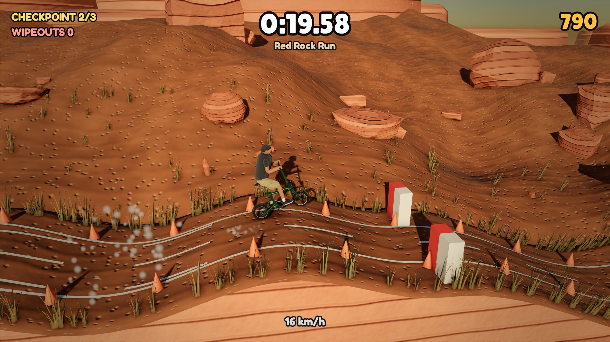
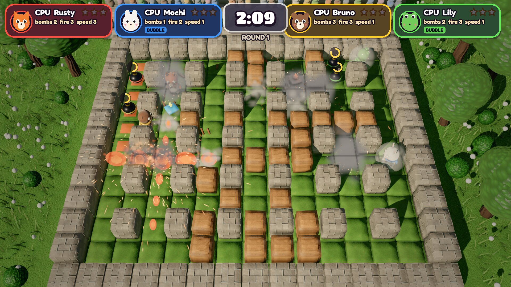
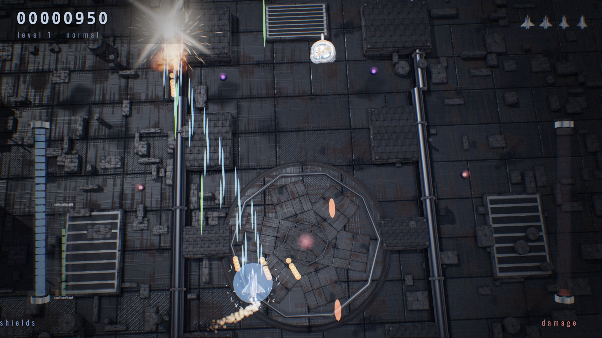
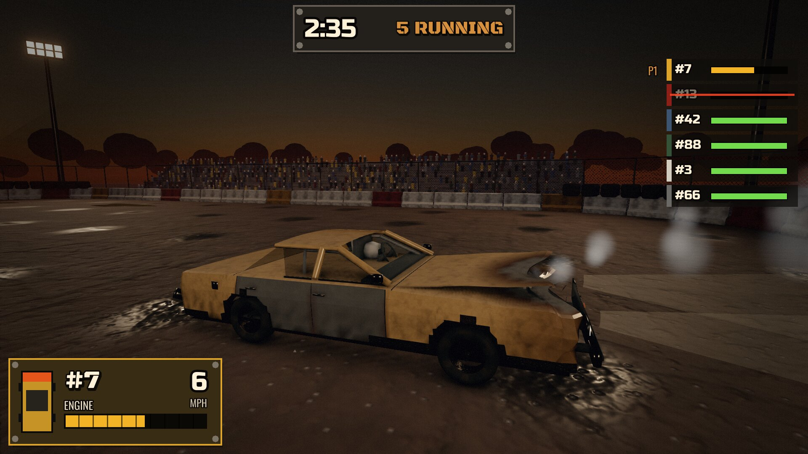
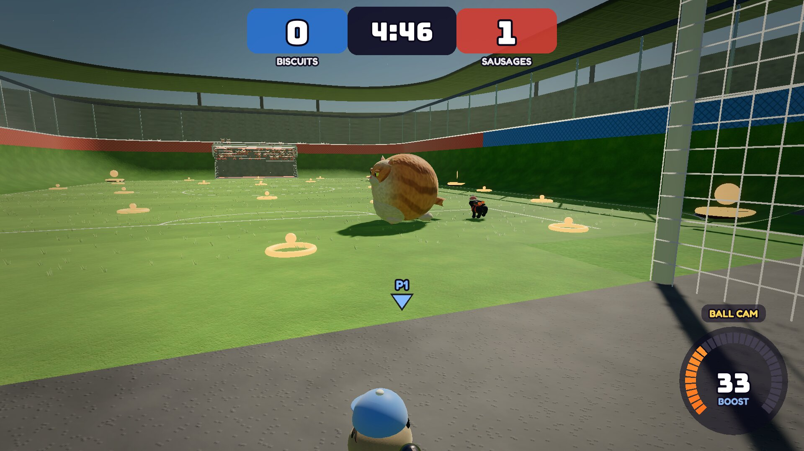
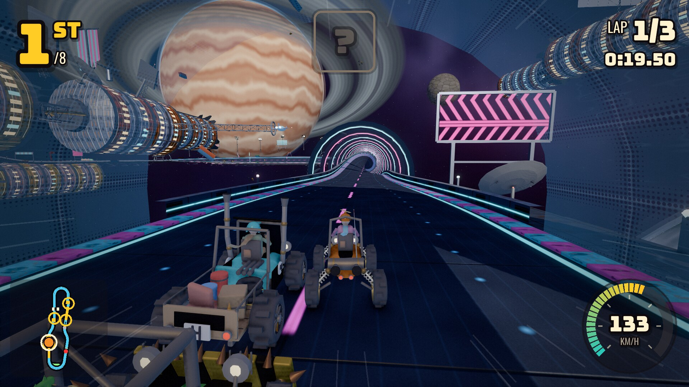
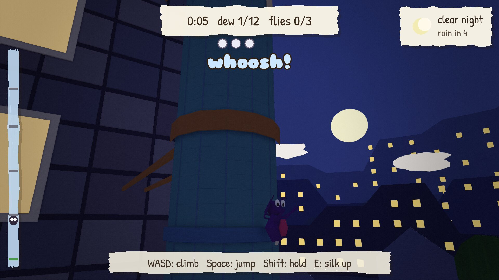

# cartwheel-examples

[](https://github.com/monteslu/cartwheel-examples/actions/workflows/ci.yml)

Seven complete games built with
[cartwheel-engine](https://github.com/monteslu/cartwheel-engine), a 2D and 3D
game engine in C. Each game builds as a native executable and as a
[wasmcart](https://github.com/wasmcart/wasmcart) cart (`.wasc`) that runs in
a browser, in Node, in a native player and in RetroArch.

Everything in the games is made by code in this repository (models,
textures, levels, sound and music) except BikeMesa’s credited venue logos and the fonts, which ship with their
licences (SIL Open Font License, and MIT for Chromite's Hack). Each game's `CREDITS` file says
what is what.

## The games

### BikeMesa




A downhill bike game. A 2D Box2D bicycle and rider ride hand-shaped lines
through nineteen 3D worlds, from a red rock canyon and a snowy slope to a
Downtown Mesa streets, a haunted town, the Moon and Mars, a big-top circus, a low-gravity candy world and a giant toybox.
Pedal, hop, lean into flips, hold poses in the air and land clean; get it
wrong and the rider tumbles through a full 3D crash. Up to four players race
split screen in four lanes, one pad each: two share the screen top and
bottom, three or four take its quarters (with three, the last quarter holds
the race clock, a mini map of the course and the standings). Each player
picks a rider and a bike before the run. A pad that joined and then does
nothing for five seconds does not hold the start: once P1 is ready, P1's (A)
starts the race and the idle seat sits it out. The folding bike, cruiser, e-bike,
DJ cargo tricycle, penny-farthing, BMX, and adult Big Wheel have distinct frame and wheel geometry. The DJ bike
carries twin speakers, a sloped controller deck and laptop; its two 20-inch
front wheels and cargo assembly steer together ahead of a 26-inch rear wheel.
It accelerates more slowly and takes longer to change lanes. The penny-farthing
has a direct-drive 60-inch front wheel, a 16-inch rear wheel, a curved backbone,
and a raised leather saddle. Its pedals turn with the front wheel even while
coasting. Each frame starts in its own default paint: green folding bike, red
cruiser, DJ bike and Big Wheel, white e-bike, black penny-farthing, and blue BMX; paint can still be
changed in the next selection step. The 20-inch BMX carries a brown, blanket-wrapped
alien in a standard 13 × 13 × 11-inch front milk crate. Hard landings and crashes
can eject him into the 3D physics world, arms flailing; he stays behind through
checkpoint resets, can be knocked along the ground by passing bikes, and returns for the next level. The e-bike has extra low-speed
motor assist that tapers out by 6 m/s. The adult Big Wheel has a 26-inch direct-drive
front wheel, twin 12-inch rear drums, a low bucket seat and forward pedals.
Its fork, handlebars, hub pedals and rider articulate during lane changes.
Night Burbs adds three big suburban jumps, oak and elm trees, warm porch lights,
and a huge glowing Moon using NASA lunar imagery. The BMX and alien cross its
face in normal play; the Moon stays distant throughout the course.
`games/bikemesa/`

### BomberDude




A 3D arena bomber for one to four players and CPU rivals. Four critters,
eight themed arenas with their own twists (conveyor belts, ice, teleporters),
Battle and Adventure modes. The rules are integer only, so every host plays
the same game. `games/bomberdude/` (its
[README](games/bomberdude/README.md) has the full controls).

### Chromite




A vertical shooter after Chromium B.S.U. (2000): its rules, enemy
behaviours and wave scripts re-implemented, its craft, logo
and instruments rebuilt in 3D. Fly a chrome cargo ship up over three stage
worlds in turn: a fortress deck of worn, rusted plating with pits down to the
machinery under it, an orbital ring of girders over a planet, and a foundry
with rivers of melt. Shields soak most of each hit and the hull takes the
rest. Kills in quick succession chain a score multiplier (up to x5), kills
made up close score double, and a falling command craft or the super bomb
turns enemy fire into score chips. An enemy that gets past costs points and
the chain; the classic rules (title menu) make it cost a ship, as the
original did. Enemy rounds are magenta and cyan with white cores, the ship's
own fire is dimmer, and the ship shows its hit point. Three guns, power-ups
for shields, repairs and ammunition, a self-destruct that sets off a super
bomb, and two command craft whose armour plates blow off as they weaken
(at half, a second attack, always charged first). Hits, bombs and a command
craft's fall rumble the pad. The
chrome reflects the deck sliding by below and the explosions beside it: a
ReflectionProbe3D captures a stand-in of the deck every other frame. Every
blast is a light of its own and every deck lamp lights the plating round it,
through clustered lighting, so a chain of explosions lights up the fortress.
Mouse, keyboard, pad or touch. `games/chromite/`

### derby




A demolition derby. Six cars on Box3D wheels in a walled dirt bowl; hits
dent the bodywork, then come smoke and fire, and the last car running wins.
Four floodlight towers light the bowl at dusk and throw the cars' shadows
across the dirt, their beams hanging in the dust and smoke; a burning wreck
lights the ground round it and scorches the dirt under it.
Up to four players split screen, one pad each: players 2-4 join on the
title with (A), and CPU cars fill the bout to six. Two players share the
screen top and bottom; three or four take its quarters (with three, the
last quarter holds the clock, the standings and a map of the arena with
every car on it). Each player has their own chase camera and HUD, and the
controls stay up in each player's view, on that player's pad, from the
countdown until they give it gas.
Pick your car on the title with left and right: the sedan is light (quick,
nimble, it dents), the wagon middleweight, the pickup and the van heavy
(slow to pull away, they take a beating); over 200 CPU bouts no body wins
more than 20% off the others. Damage drives: a hit beside a front wheel
bends it and the car pulls toward that side, a battered flank's tyres grip
less, a failing engine tops out lower. A big hit on your car lands with a
beat (the bout runs at a third of its speed for a tenth of a second while
the sound runs on), a ring of dust thrown out along the dirt, a thump in the
pad and the crowd's roar; the camera never shakes. When two are left the
crowd and the music rise and the chase camera eases back. A burst radiator
vents steam, a dying engine leaks a pool of oil. Gates `derby-opening` (a
newcomer survives the first seconds, damage drives, the classes; studies run
in the cart) and `derby-beat`.
`games/derby/`

### pugball




Soccer with jet-pack pugs and a round, cross cat for a ball. 1v1 to 3v3 with
players and CPUs, five stadiums open for exhibitions from the start, and the
Pug Cup, whose wins unlock hats and trails.
Party rules on the team sheet's KICK OFF row: MOON CAT (the cat floats at 40%
gravity) and BOTTOMLESS BOOST. Up to four
players share the screen, one pad each: pads 2-4 join on the team sheet and
pick their side, and CPUs fill the other slots. Two players split the screen
top and bottom, three or four take its quarters (with three, the last
quarter holds the score, the clock and a mini map of the pitch). Each player
has a chase camera with its own ball cam and boost gauge. The first kickoff
shows how to drive (the throttle is on the triggers) under the countdown, in
every player's view with that player's own buttons, alone or split (gate
`pugball-newcomer`: a newcomer reaches the cat with a second pad joined and
idle; the control, `sw split_how 0`, leaves the line out). The kickoff
countdown stands beside the cat, never over it; in a goal mouth the chase
camera comes in over the pug, clear of the posts; the view opens up as a pug
nears supersonic; full boost pads glow and empty ones go dark (gate
`pugball-feel`). The sun casts
cascaded shadows; at night the floodlight ring lights the pitch (clustered
spot lights, the corner pylons casting shadows). The goal nets are cloth that
billows when the cat hits them, and the stands ring with each stadium's
reverb (headphones get 3D sound, from the pause screen). The match runs on
Box3D. `games/pugball/`

### racer




A kart racer on rollercoaster tracks, in a post-apocalyptic racing league that
runs through eight very different places: a salt flat at dawn, a flooded
neon city in a storm, an abandoned amusement park whose coaster is the
course, a burning refinery, a spillway dam, a frozen mountain pass under an
aurora, a jungle temple and a wrecked orbital station. The roads loop the
loop, corkscrew, jump gaps, dive through tunnels and glass tubes and ford
flooded streets. Six junkyard karts, drifts that charge a mini-turbo, tricks
in the air, slipstreams, and item boxes with single, triple and homing
missiles, a boomerang, bombs, mines, oil, shields, turbos and a shockwave
you hop over. Catch-up keeps the pack close, and the CPU drivers race fair:
they give way to a player closing from behind and hold fire at the start.
A wacky radio announcer calls the race, and pads rumble on hits and bumps.

Modes: single races and cups over three speed classes, a time trial against
your own ghost for medals, balloon battles in four arenas, capture the flag
on four long maps (a tower-to-tower asteroid in space with teleports up the
towers and a drive off the roof, a red canyon, two dams across a flooded
canyon with a broken bridge to jump, and a low-gravity orbital foundry) with
team-colour outlines, king of
the mountain, and assault: one team storms a fortress stage by
stage (blow the gates, break the targets, hold the zones, get out) while the
other holds it with gun nests, then they swap and the second attack has to
beat the first one's time. Four assault maps: a beach landing up a sea cliff,
a jungle temple keep, a prison breakout down a canyon and an oil rig over
open sea. The arenas add flak, shock orbs (set one off with a blaster bolt
for the combo), rocket pods and a rail lance to the item boxes. One player
against seven CPU drivers, or two to four on a split
screen, one pad each. A pad that joined and then does nothing for five
seconds on the ride pick does not hold the race: P1's READY! button turns to
START NOW and the idle seat sits the race out. The race ends 40 seconds after
the first person over the line (with nobody racing, the first kart), so a
slow newcomer is never cut off because the computer field is home. `games/racer/`

### spout




A paper spider climbs a rain spout. The weather turns from sun to rain;
rain makes the paper wraps slick and sends water down the spout, so brace
or be washed back to the last bracket. Five spouts, each opening the next.
The rain pushes a stream round the pipe toward the spider, so its waves
cross the climb and must be met braced; the paper bird marks where the
spider will be. Each spout has a par time and a paper medal (gold, silver,
bronze). The HUD keeps to the rails and the banners to the lower third, off
the pipe above the spider; on High and Ultra a miniature's depth of field
keeps the spider sharp and the garden soft. Gates `spout-newcomer` (a
newcomer climbs the first spout by the wave fronts it sees) and `spout-feel`.
`games/spout/`

## Play

Tagged versions are on the
[Releases](https://github.com/monteslu/cartwheel-examples/releases) page: the
seven carts and each game's native builds.

| File | Platform | Notes |
|---|---|---|
| `<game>.wasc` | any wasmcart host | GL and WebGPU in one cart: WebGPU where the host has it, GL otherwise |
| `<game>-<v>-linux-x64.tar.gz`, `.AppImage` | Linux x64 | needs glibc 2.34 or newer |
| `<game>-<v>-linux-arm64.tar.gz`, `.AppImage` | Linux arm64 | the same |
| `<game>-<v>-windows-x64.zip` | Windows 10 or later, x64 | unzip and run `<game>.exe` |
| `<game>-<v>-macos-arm64.zip` | macOS 11 or later, Apple silicon | signed ad hoc, not notarized: the first time, right-click the app and choose Open |
| `<game>-<v>-android-arm64-debug.apk` | Android 7 or later, arm64 | signed with a debug key, for sideloading |

The native builds render with WebGPU (Dawn) and fall back to OpenGL ES 3.0
when WebGPU does not start; `CW_GPU=gl` or `CW_GPU=webgpu` in the environment
picks one. Every push also builds everything: the repository's
[Actions](https://github.com/monteslu/cartwheel-examples/actions) tab, the
latest green run on `main`, then **Artifacts** (`release-carts`,
`release-<platform>`).

Hosts that run them:

- [wasmcart](https://github.com/wasmcart/wasmcart), the web and Node player:
  `npx wasmcart bikemesa.wasc`
- [wasmcart-native](https://github.com/wasmcart/wasmcart-native), a native
  player
- [wasmcart-libretro](https://github.com/wasmcart/wasmcart-libretro), a
  libretro core for RetroArch (it runs a cart's GL path)

## Build

The games build against cartwheel-engine's prebuilt SDKs: the engine,
three.c, Box2D, Box3D, SDL2, Dawn and the rest come compiled (one SDK per
target, attached to the engine's release; see the engine's
[docs/sdk.md](https://github.com/monteslu/cartwheel-engine/blob/main/docs/sdk.md)),
so a build compiles only the games. You need cmake, ninja, a C17 compiler,
Node.js, git and curl; on Linux also the EGL and GLESv2 runtime (Mesa). On
Ubuntu:

```sh
sudo apt-get install cmake ninja-build clang nodejs npm curl libegl1 libgles2
```

Then:

```sh
scripts/fetch-deps.sh   # the SDKs for this machine and for carts, pinned with sha256 in scripts/deps.lock
scripts/build.sh        # build/native and build/cart-wgpu
```

`scripts/build.sh` builds these trees:

| Tree | What | Where |
|---|---|---|
| `build/native` | native executables, this machine's compiler | `build/native/games/<game>/<app>` |
| `build/cart-wgpu` | dual GL + WebGPU carts (the only cart: GL is tested by running it on a GL host) | `build/cart-wgpu/carts/<app>.wasc` |
| `build/<target>` | a platform's release build, with the target's SDK and toolchain: `linux-x64`, `linux-arm64`, `windows-x64` (cross-compiled), `android-arm64`, `macos-arm64` (on a Mac) | `build/<target>/games/<game>/<app>` |

`TARGETS="native"` (or any of the trees) builds some trees,
Carts link as dev carts by default (no ThinLTO, no wasm-opt: seconds instead
of a minute, the same simulation); `RELEASE=1` links them as releases ship.
`BUILD_TYPE=Debug` makes a debug build, and any arguments are ninja targets:
`scripts/build.sh pugball` builds only pugball in each tree. A platform tree
needs its SDK and toolchain: `CW_SDK_TARGETS=windows-x64 CW_TOOLCHAINS=1
scripts/fetch-deps.sh`. Each game's `project.cwproj` holds its export
presets; `node deps/cartwheel-sdk/<host>/tools/cwexport.mjs --project
games/<game> --preset <target> --build build/<target>` packages a built tree
as the releases do.

To build the engine from source instead (to work on it, or on a machine no
SDK runs on), fetch with `CARTWHEEL_ENGINE_SOURCE=1 scripts/fetch-deps.sh`
(the engine at the pinned commit and its own dependencies) or
`CARTWHEEL_ENGINE=../cartwheel-engine scripts/fetch-deps.sh` (a checkout);
`scripts/build.sh` then builds the engine with the games, as the engine's
project.

## Run

Natively:

```sh
build/native/project/games/pugball/pugball
```

The carts with any wasmcart host:

```sh
npx wasmcart build/cart-wgpu/carts/pugball.wasc
```

Or through the engine's runner, which drives every host the same way (frame
count, input script, screenshot, debug state):

```sh
CW_PROJECT_ROOT=$PWD node deps/cartwheel-engine/tools/run-cart.mjs --host native --app pugball --frames 300 --shot out/pugball.png
```

## Tests

Each game has gates in `tests/gates.json`. A gate runs an app on every host
it names with the same frame count and input script, and compares each run
with the native one: the frames within a pixel bound, and the game's named
debug state (scores, positions, hashes of the simulation) exactly. Each gate
also runs a control (one frame short, or a different input) that must fail,
so a gate that cannot tell runs apart fails too. Gates with a `webgpu`
entry run again on WebGPU and are compared with the GL run.

```sh
node tests/gate.mjs --hosts native                    # every gate, native, GL
node tests/gate.mjs --hosts native --gpu webgpu       # the same on WebGPU
node tests/gate.mjs bikemesa-ride derby-auto          # some gates, every host they name
```

`tests/gate.mjs` runs cartwheel-engine's gate runner with
`CW_PROJECT_ROOT` set to this repository. The engine's
[testing guide](https://github.com/monteslu/cartwheel-engine/blob/main/docs/guides/testing.md)
covers the hosts (native, Chromium, wasmcart-native, romdev), the test GPU
settings it expects in `~/.config/cartwheel/`, and the gate format.

The newcomer gates (`tests/<game>-newcomer.mjs`, and `tests/racer-slow-finish.mjs`)
play a game's built cart through romdev on GL and WebGPU the way a first-time
player would: only by what the screen shows, slowly, and beside a second pad
that joined and then sits idle. AGENTS.md describes what every game needs from
them.

`tests/racer-grounded.mjs` plays racer's cart through romdev on GL and WebGPU on
every map and checks that the karts sit on the road: the player's kart throws its
shadow and darkens the road where it meets it at every preset (the same paused frame
drawn with them and without), and over a lap the cart measures every frame each
kart's drawn tyres against the road under them, including how long any kart stays drawn a
little above it (a run longer than a hop that low lasts is a hover). Its controls (`sw sun_short 1`
with `sw contact 0`, `sw wheel_lag 1`, and `gap lift 80`) bring back the old way or a hovering kart
and must fail. `--legs float` adds a report of props standing a little above the ground near the
road (the `floatcheck` debug command), with frames of each to look at.

`tests/racer-jump-camera.mjs` plays racer's cart through romdev on GL and WebGPU and
drives over every jump of every map with the gas held (each jump on its own, then a
lap). The cart records each flight (the `jcam.*` debug fields): from the take-off to
just after the landing the kart stays framed on the screen at the chase distance, the
camera is never held as for a fall, and the eye never cuts or jolts. A fall off the
side of the orbit's road still holds the camera where the fall began. Its control
(`sw jump_hold 1`, the flight held at the lip like a fall) must fail on every map.
Frames before, during and after each map's first jump are kept in `out/racer-jump-camera`.

`tests/bikemesa-rides.mjs` (gate `bikemesa-rides`) plays BikeMesa's ride gates
(`tests/bikemesa-rides.json`: tricks, lanes, contact between riders, the wrecking
ball, the loop, the moon's big jump) on the cart through romdev on GL and WebGPU,
timed from the game's own state instead of frame numbers: it presses through the
menus as each screen comes up (or sends a start request such as `track 2`), then
waits on the debug field `ride.start` (the tick of the countdown's GO) and plays
each ride's input in ticks from GO, so a host that spends longer loading lands the
same presses on the same stretch of track. Each ride's named state must match its
`expect`, the WebGPU leg must match the GL leg exactly, and each ride's control
must miss `expect`.

Without GPU hardware, `CW_TEST_GPU=software` runs on Mesa's software
renderers (llvmpipe for GL, lavapipe for WebGPU), as CI does:

```sh
CW_TEST_GPU=software node tests/gate.mjs bikemesa-auto --hosts native
CW_TEST_GPU=software node tests/gate.mjs bikemesa-auto --hosts native --gpu webgpu
```

### Graphics presets

Every game has the engine's five graphics presets (Very Low, Low, Medium, High, Ultra, plus Auto), and the
resolution is a setting of its own that no preset changes. Four kinds of check hold them, each a script gate in
`tests/gates.json` run inside a GPU suite (`node deps/cartwheel-engine/tools/with-gpu-suite.mjs <name> node <script>`):

- `tests/<game>-quality.mjs`: every program state the game draws at every preset, on GL and WebGPU, is in its
  table (0 missing, 0 skipped draws), each scene proven reached by its own debug state
  (`tests/lib/quality-sweep.mjs`; `--quality verylow`, `--gpu gl`, `--scene <regex>` and `--shard i/n` narrow a
  run). Control: the table with one Very Low state taken out must report it.
- `tests/quality-range-1.mjs` to `-8.mjs`: the GPU time of each preset in play at 1080p (the engine's
  `tools/quality-range.mjs` over `tests/quality-range-scenes.json`, each game with its measured share of High).
  Control: every preset drawing High must fail.
- `tests/quality-grounding.mjs`: on Very Low every caster big enough to read keeps the shadow at its base that
  High draws, so nothing looks as if it floats. Control: a frame with no shadows must fail.
- `tests/cart-art.mjs`: every release cart carries its launcher art (`games/<game>/art`, see Layout). Control: a manifest with no cover.
- `tests/cart-version.mjs`: every cart's manifest version is this build's (the tag's on a `v*` tag, else `<last tag>-dev.g<commit>`); in the release, every package's name carries it too. Control: a cart rewritten to another version.

### Split-screen cost

`tests/bikemesa-split-bench.mjs` measures what each extra player costs:
the self-playing BikeMesa on the same ride with one to four riders, native,
GL and WebGPU, on the test GPU. Per player count it prints the CPU per frame
on the main thread's clock (simulation and render submission), the GPU time
per frame by pass, the draw calls, and each against one player in percent.

```sh
node tests/bikemesa-split-bench.mjs                         # GL and WebGPU, 1-4 players, 3 runs each
node tests/bikemesa-split-bench.mjs --gpus webgpu --runs 5
```

`tests/pugball-split-bench.mjs` does the same for Pugball: one 2v2 in the
first stadium with one to four players (CPUs fill the other pugs), every pad
driving at the cat from the kickoff (`tests/pugball-split1.json` to
`pugball-split4.json`). The CPU numbers come from runs without GPU timers,
the GPU numbers from runs with them.

```sh
node tests/pugball-split-bench.mjs                          # GL and WebGPU, 1-4 players, 5 rounds
node tests/pugball-split-bench.mjs --gpus gl --players 1,4 --runs 3
```

`tests/derby-split-bench.mjs` plays one Derby bout at 1920x1080 with one to
four players, every pad joining on the title and then driving its own line
into the same pile-up. `--pairs N` also runs one player and n players side
by side N times: both see the same load on a busy machine, so their ratio
holds still where runs one after the other drift. Run it through the
engine's GPU suite wrapper:

```sh
node deps/cartwheel-engine/tools/with-gpu-suite.mjs derby-split-bench node tests/derby-split-bench.mjs
node deps/cartwheel-engine/tools/with-gpu-suite.mjs derby-split-bench node tests/derby-split-bench.mjs --pairs 7 --gpus webgpu --players 1,4
```

## CI

[`.github/workflows/ci.yml`](.github/workflows/ci.yml) runs on every push to
`main`, on pull requests and by hand (workflow_dispatch). Every job builds
against the pinned SDKs.

- **Carts**: the dual carts, after the button prompt check
  (`tools/check-prompts.mjs` from the SDK) over the games in `PROMPT_GAMES`:
  their prompts name actions and let the engine draw each button (AGENTS.md).
- **Gates** (nightly, and by hand): each game's `_auto` gate in full,
  natively on GL and then on WebGPU, with Mesa's software renderers at the
  games' own 960x540 (`CW_RENDER_SCALE=1`): hours of software rendering. The
  full gate set runs locally with `tests/gate.mjs`.
- **Native** (one job per platform): the games built with the target's SDK
  and toolchain and packaged with cwexport. Where the runner can run them
  (Linux x64 and arm64 on Mesa's software renderers, macOS on the runner's
  Metal device), the first 200 frames of each game's `_auto` replay run on
  GL and on WebGPU (`tests/native-replay.mjs --frames 200`; macOS runners draw
  GL at seconds a frame, so there the replays run on WebGPU and GL is
  launch-checked on one game). Windows builds cross-compile on Linux and run
  on a Windows runner (ANGLE on Direct3D 11, Dawn on Direct3D 12; the
  runner renders on the CPU, so one game's slice is replayed there); that job
  also adds Microsoft's Visual C++ runtime, which Dawn links, beside each
  game. The Android APKs are launched on an emulator (an x86_64 image
  running arm64 code).
- **Replays across platforms**: every platform's and API's state after those
  frames must equal Linux x64 GL's, field for field (`tests/compare-replays.mjs`).

Pushing a `v*` tag runs the same jobs and publishes a GitHub release with the
carts and each game's native builds: `git tag v0.6.0 && git push origin
v0.6.0`. The release checks that every cart's manifest and every package's
name carry the tag's version (`tests/cart-version.mjs`).

Every cart's manifest says which version it is, and the build works it out
from the checkout (the engine's `cw_add_app`): a build of a `v*` tag is that
version (`0.19.5`), any other build the last tag plus the commit
(`0.19.5-dev.g1a2b3c4`), so a cart built locally or from `main` is never taken
for a release. `cwexport` gives the native packages
the same version.

## Layout

| Path | Contents |
|---|---|
| `games/<game>/` | one game: its C sources, `CMakeLists.txt`, `CREDITS`, `project.cwproj` (native export presets, the description and author), `assets/` and `tools/` |
| `games/<game>/art/` | its launcher art, packed into the cart: `art.json`, an icon, a cover with the name, a background and a logo, the title screen and labelled screenshots (wasmcart's [art guide](https://github.com/wasmcart/wasmcart/blob/main/docs/art.md)) |
| `games/<game>/assets/` | what the game packs: scenes, colour grades, audio, fonts, `roots.txt` (the pack manifest), `input.cfg`, `project.cwproj` |
| `games/<game>/tools/` | the scripts that generate the game's assets and gate inputs, committed next to their output |
| `games/<game>/programs/` | the game's three.c program table: `<game>.txt` and the C generated from it |
| `tests/gates.json` | every gate |
| `tests/<game>-*.json` | input scripts for the gates |
| `tests/gate.mjs` | runs the gates |
| `tests/<game>-quality.mjs`, `tests/quality-*.mjs`, `tests/lib/` | the graphics preset checks (above) |
| `tests/cart-art.mjs` | every release cart carries its art |
| `tests/cart-version.mjs` | every cart's manifest (and every release package's name) carries this build's version |
| `scripts/deps.lock` | the pinned cartwheel-engine commit and its SDKs (sha256) |
| `scripts/fetch-deps.sh`, `scripts/build.sh` | fetch the SDKs (or the engine) and build |
| `tests/native-replay.mjs`, `tests/compare-replays.mjs` | the `_auto` replays on any platform's build, and their comparison |
| `CMakeLists.txt` | the top of the build against an SDK (`find_package(cartwheel)`), adding each game; with the engine from source, the engine's project |
| `deps/`, `build/`, `out/` | fetched dependencies, build trees, test output (all gitignored) |

## Working on the games

- Each game is a cartwheel app: `cw_main` returns a `cw_app_desc` with a
  fixed-tick update and a render callback. The engine's headers
  (`deps/cartwheel-engine/include/cartwheel/*.h`) are its API reference.
- A game is built several times from the same sources with different
  defines: `<game>_auto` plays its gate's input script by itself (for hosts
  that send no input), and test builds such as `pugball_cup` start from a
  given save. `games/<game>/CMakeLists.txt` lists them.
- The simulation is deterministic on every host: fixed ticks, randomness from
  `cw_rng`, trig from `cartwheel/math.h`, no fast-math. State a gate checks
  is published by name with `cw_debug_*`.
- Generated assets come from the game's `tools/` scripts: change the script,
  rerun it and commit both. The audio scripts need ffmpeg.
- When a game draws a new material state, the gates fail and name it. Add it
  to the game's program table with the engine's tool,
  `node deps/cartwheel-sdk/<host>/tools/programs.mjs <app> --build build/native`
  (or `deps/cartwheel-engine/tools/programs.mjs` with the engine from
  source), and commit the generated files.
- To work on the engine and the games together, link an engine checkout:
  `CARTWHEEL_ENGINE=../cartwheel-engine scripts/fetch-deps.sh`. Engine
  changes go into cartwheel-engine first; then pin its new commit in
  `scripts/deps.lock`.
- A change is done when its gates pass natively on GL and WebGPU.

## License

MIT, see [LICENSE](LICENSE). The fonts keep their own licence (SIL Open Font
License 1.1), shipped beside each font.
